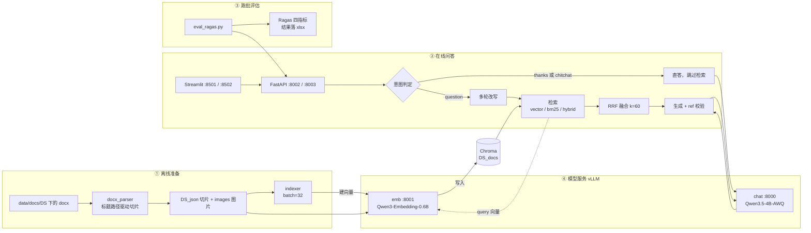

# MPMQA RAG — 工业设备手册多轮问答系统

面向工业物联网设备手册（**GWM / MDM**）的**全本地化** RAG 多轮问答系统：

> vLLM 双模型服务 → 标题驱动切片 → Chroma 向量库 → 三路检索（语义 / BM25 / RRF 混合） → 意图分流 + 多轮改写 → 带图引用生成 → Streamlit 图文前端 → Ragas 跑批评估

- 🔒 **全链路私有部署** —— 模型、向量库、服务全部跑在本机，不调用任何外部 API
- 🖼 **答案可溯源到原图** —— 回答中的 `[ref:uid]` 由后端校验，前端渲染成手册里的**真实截图**，可拖拽缩放
- 🗂 **多数据集隔离** —— `--dataset` 一个参数驱动 collection / 图片路径 / 服务端口全套隔离，GWM 与 MDM 可同时在线互不干扰
- 📊 **评估闭环** —— Ragas 四指标按文档逐份跑批，结果落 `xlsx`，可对比不同检索模式

---

## 目录

- [架构](#架构)
- [目录结构](#目录结构)
- [环境与依赖](#环境与依赖)
- [快速开始](#快速开始)
- [配置说明](#配置说明)
- [API](#api)
- [数据准备](#数据准备)
- [评估结果](#评估结果)
- [已知限制](#已知限制)
- [文档](#文档)

---

## 架构


> 上图为矢量图。若当前平台不渲染 SVG，可打开
> [`docs/diagrams/rag-architecture.html`](docs/diagrams/rag-architecture.html)（自带 PNG 导出按钮）
> 或 [`docs/diagrams/rag-architecture.drawio`](docs/diagrams/rag-architecture.drawio)。
> 文字版逐段说明见 [`docs/architecture.md`](docs/architecture.md)，图源与改图方法见 [`docs/diagrams/README.md`](docs/diagrams/README.md)。

流程概览：



三个检索模式的区别（`backend/retriever.py`）：

| 模式 | 前端按钮 | 实现 | 排序依据 |
|---|---|---|---|
| `vector` | 语义检索 | Chroma HNSW 余弦距离检索 | 距离升序（近→远），`dist > 1.0` 的丢弃 |
| `bm25` | 精确检索 | `rank_bm25.BM25Okapi`，进程启动时对全库建索引 | BM25 分数降序 |
| `hybrid` | 混合检索（默认） | 两路各取 `top_k` 再 RRF 融合 | `Σ 1/(60 + rank)` 降序 |

> RRF 融合公式：`score(d) = Σ_i 1 / (rrf_k + rank_i(d))`，`rrf_k = 60`（`backend/config.py`）。
> 融合后每条结果的 `vec_score` / `bm25_score` / `rrf_score` 都会回传，前端「查看本轮召回切片」里可直接对比。

### 一句话回答链路（`backend/api.py` 的 `/ask`）

1. 取会话历史（内存 `SessionManager`，最多 3 轮，TTL 1800s）
2. **意图判定** → `thanks` / `chitchat` 走直答分支，**不触发检索**，省一次全链路开销
3. `question` 走 **多轮改写**（把「它支持吗」补全成独立检索语句，并剥掉模型可能带出的 `rewritten query:` 前缀）
4. 用改写后的 query 检索 → 拿 `top_k=10` 条切片
5. 拼上下文生成答案（上下文里每段带 `uid`）
6. **引用后处理**：`normalize_ref_position` → `dedup_refs`（删掉模型编造或重复的 `[ref:uid]`）→ 入库历史前 `strip_refs`
7. 返回 `answer` + `sources`（含 `uid` / 各分数 / 原文 / 对应图片名）

前端拿到 `sources` 后建立 `uid → 图片路径` 映射，把 `[ref:xxx]` **就地替换成手册原图**渲染，其余文字按段落输出。

---

## 目录结构

```
main/
├── ingestion/                 # 离线：手册 → 切片 → 向量库
│   ├── docx_parser.py         #   按 Word 标题层级切片，抽出内联图片并按序命名 img_0001.png
│   ├── embedding_client.py    #   极薄的 OpenAI 兼容 embedding 客户端
│   └── indexer.py             #   读切片 JSON → 批量 embedding → Chroma upsert（batch=32 / cosine）
│
├── backend/                   # 在线：RAG 服务
│   ├── api.py                 #   FastAPI /ask、SessionManager（内存会话 + TTL 清理线程）
│   ├── chains.py              #   4 条 LangChain 链：rag / intent / rewrite / direct_reply + ref 后处理
│   ├── retriever.py           #   vector / bm25 / hybrid(RRF) 三路检索
│   ├── config.py              #   全部可调参数（端口、模型名、top_k、rrf_k、会话 TTL…）
│   └── prompts/               #   提示词（当前为英文版 *_en.txt）
│
├── frontend/
│   ├── app.py                 # Streamlit 聊天界面，含 [ref] → 图片渲染
│   └── config.py              #   前端配置 + 中文模式名到 API mode 的映射
│
├── deploy/                    # 模型服务启停
│   ├── common.sh              #   conda 环境、CUDA、代理白名单、wait_ready 轮询函数
│   ├── deploy_chat.sh         #   vLLM chat 服务   :8000
│   ├── deploy_emb.sh          #   vLLM embedding 服务 :8001
│   ├── deploy_all.sh          #   依次拉起上面两个
│   └── start.txt              #   自定义端口 / 多实例的启动示例
│
├── eval/
│   ├── eval_ragas.py          # 调 /ask 收集答案与上下文 → Ragas 四指标 → xlsx
│   └── run_eval.sh            # 数据集 × 检索模式的批量回归
│
├── docs/
│   ├── architecture.md        # 文字版架构说明（逐段、含字段级细节）
│   └── diagrams/              # 矢量图源（SVG / drawio / HTML）+ 生成器
│
├── data/                      # 运行时数据（默认不入库，见 .gitignore）
│   ├── docs/{DS}/             #   手册原稿 .docx
│   ├── docs/{DS}_json/        #   切片产物（docx_parser 生成）
│   ├── images/{DS}/           #   抽出的插图（docx_parser 生成）
│   ├── test/{DS}/             #   评测集 xlsx（query / answer / type）
│   └── chroma_db/{ds}/        #   向量库（indexer 生成）
│
├── ragas_results/{DS}/        # 评估结果 xlsx（入库，体积很小）
├── quick_start.txt            # 最短路命令备忘
└── README.md
```

**关键约定：所有命令都在项目根目录 `main/` 下执行。** `data/` 路径是相对 CWD 解析的（`backend/config.py` 里的 `image_base_dir` / `chroma_path`），换目录执行会找不到库和图片。

---

## 环境与依赖

开发/运行环境为 **WSL2 + conda**，分两个环境（职责不同，别混用）：

| 环境 | 用途 | 关键包（实测版本） |
|---|---|---|
| `rag` | 模型服务 / 入库 / 后端 / 前端 | `vllm 0.31.0`、`chromadb 1.5.9`、`streamlit 1.65.0`、`fastapi 0.136.3`、`uvicorn 0.54.0`、`openai 3.29.0`、`python-docx 1.2.0`、`rank-bm25 0.2.2`、`torch 2.13.0`、`transformers 5.17.0`、`modelscope 1.40.2` |
| `ragas` | 跑批评估 | `ragas 0.4.3`、`langchain 1.4.5`、`langchain-openai 1.7.1`、`datasets 5.1.0`、`openpyxl 3.1.5`、`pandas 3.0.6` |

Python **3.11**。

> 为什么分两个环境：`ragas` 需要 `langchain 1.x` + `datasets`，与 vLLM 的依赖树容易打架；评估脚本只通过 HTTP 调 `/ask`，与 `rag` 环境完全解耦，拆开最省事。
> 同理 `rag` 环境**没装 openpyxl**，读 xlsx 请用 `ragas` 环境。

其他前置条件：

- **NVIDIA GPU**（chat + embedding 双服务按 `gpu-memory-utilization` 切显存，默认合计 0.90）
- **CUDA Toolkit** 已装在 conda 环境内（`deploy/common.sh` 把 `CUDA_HOME` 指向 `envs/rag/.../nvidia/cu13` 并加进 `PATH`）
- 模型权重放本地（默认 `~/models/`），配合 `VLLM_USE_MODELSCOPE=true` 从 ModelScope 拉取
- 开代理时已把 `127.0.0.1 / localhost` 加进 `no_proxy`，否则本机 HTTP 调用会被代理拦掉

导出当前环境依赖：

```bash
conda activate rag    && pip freeze > requirements-rag.txt
conda activate ragas  && pip freeze > requirements-ragas.txt
```


---

## 快速开始

所有命令在 **项目根目录** 执行。最短路径也记在 [`quick_start.txt`](quick_start.txt)。

### 0. 起模型服务（chat + embedding）

```bash
bash deploy/deploy_all.sh
```

脚本会依次拉起两个 vLLM 服务，并各自轮询 `/health`（最多 60 次 × 3s）直到就绪，随后返回。日志在 `$LOG_DIR/vllm-chat.log`、`$LOG_DIR/vllm-emb.log`（默认 `~/logs/`）。

> **注意**：服务是以后台子进程方式启动的，父脚本退出后进程仍存活；但它仍挂在当前终端会话下，**直接关掉终端可能连带被杀**。长期运行建议放进 `tmux` / `screen`，或用 `setsid` / `nohup` 拉起。

只重启某一个：

```bash
bash deploy/deploy_chat.sh      # 只重启 chat (:8000)
bash deploy/deploy_emb.sh       # 只重启 embedding (:8001)
```

自定义端口 / 模型（环境变量注入，见 [`deploy/start.txt`](deploy/start.txt)）：

```bash
CHAT_PORT=8010 CHAT_MODEL=~/models/AnotherModel bash deploy/deploy_chat.sh
```

> WSL2 下显存吃紧的话，可以先 `nvidia-smi` 看占用，再调 `CHAT_GPU_UTIL` / `EMB_GPU_UTIL` 重跑。

### 1. 切片（docx → JSON + 图片）

```bash
python ingestion/docx_parser.py --dataset GWM
python ingestion/docx_parser.py --dataset MDM
```

输入 `./data/docs/{DS}/*.docx`，输出切片 `./data/docs/{DS}_json/*.json` 与插图 `./data/images/{DS}/<文档名>/img_0001.png`。

### 2. 入库（JSON → Chroma）

```bash
python ingestion/indexer.py --dataset GWM
python ingestion/indexer.py --dataset MDM
```

对每条切片调 embedding 服务（batch=32）后 upsert 进 `{DS}_docs` collection，路径 `./data/chroma_db/{ds}`。
collection 用的是 **upsert**，所以重复执行是幂等的，不会产生重复数据。

### 3. 起后端（每个数据集一个实例）

```bash
python backend/api.py --dataset GWM --port 8002      # GWM
python backend/api.py --dataset MDM --port 8003      # MDM
```

启动时会：加载 embedding 模型客户端 → 连 Chroma → **对全库建 BM25 内存索引**（切片多时这一步需要几秒到几十秒，日志会打印 `>>> BM25 索引已建，共 N 条`）→ 编译提示词链 → 起会话清理线程。

### 4. 起前端

```bash
# GWM
streamlit run frontend/app.py --server.port 8501 -- \
  --api-url http://127.0.0.1:8002/ask \
  --image-base ./data/images/GWM/ \
  --title-suffix "[GWM]"

# MDM
streamlit run frontend/app.py --server.port 8502 -- \
  --api-url http://127.0.0.1:8003/ask \
  --image-base ./data/images/MDM/ \
  --title-suffix "[MDM]"
```

浏览器打开 <http://localhost:8501>。左上「清空对话」= 换新 `session_id`（后端历史随之清空）；每条回答下方都有「查看本轮召回切片（调试）」折叠框，展开可看到每个切片的 uid 与三种分数。

### 5. 跑评估

```bash
# 单次：指定数据集与检索模式
python eval/eval_ragas.py --dataset GWM --mode vector

# 批量回归（改 run_eval.sh 里的 DATASETS / MODES 数组）
bash eval/run_eval.sh
```

> 评估脚本依赖 `ragas` 环境，且**必须先起好后端**（默认打 `http://localhost:8002/ask`，即 GWM）。`run_eval.sh` 会自动按数据集选端口。

### 多实例部署

GWM 与 MDM 同时在线的最小配置就是上面的 8002/8003 + 8501/8502；如果显存够，也可以给 MDM 单独一套模型服务（`CHAT_PORT=8010 EMB_PORT=8011`），再改 `backend/config.py` 里的 `vllm_chat_url` / `vllm_embed_url`。


---

## 配置说明

### 模型服务（`deploy/*.sh`，环境变量覆盖）

| 变量 | 默认值 | 说明 |
|---|---|---|
| `CHAT_MODEL` | `~/models/Qwen3.5-4B-AWQ-4bit` | chat 权重路径 |
| `CHAT_PORT` | `8000` | chat 端口 |
| `CHAT_SERVED_NAME` | `qwen3.5-4b` | 对外模型名（须与 `backend/config.py` 的 `chat_model` 一致） |
| `CHAT_MAX_LEN` | `8192` | 最大上下文长度 |
| `CHAT_MAX_SEQS` | `8` | 并发序列数 |
| `CHAT_GPU_UTIL` | `0.65` | chat 显存占比 |
| `EMB_MODEL` | `~/models/Qwen3-Embedding-0.6B` | embedding 权重路径 |
| `EMB_PORT` | `8001` | embedding 端口 |
| `EMB_SERVED_NAME` | `qwen3-embedding-0.6b` | 对外模型名 |
| `EMB_MAX_LEN` | `800` | 与切片长度匹配，勿随意调大 |
| `EMB_MAX_SEQS` | `8` | |
| `EMB_GPU_UTIL` | `0.25` | embedding 显存占比（合计 0.90，留 10% 余量） |

chat 额外带了 `--enforce-eager`（关闭 CUDA Graph，省显存、启动快，代价是少量吞吐）与 `--dtype half`。

### 后端（`backend/config.py`）

| 字段 | 默认 | 说明 |
|---|---|---|
| `dataset` | `GWM` | 由 `--dataset` 传入，派生下面的路径与 collection |
| `collection_name` | `{dataset}_docs` | Chroma collection |
| `chroma_path` | `./data/chroma_db/{dataset 小写}` | 向量库目录 |
| `image_base_dir` | `./data/images/{dataset}/` | 前端图片根目录（后端回传图片名，前端拼路径） |
| `vllm_chat_url` / `vllm_embed_url` | `:8000/v1` / `:8001/v1` | OpenAI 兼容端点 |
| `chat_model` / `embed_model` | `qwen3.5-4b` / `qwen3-embedding-0.6b` | 须与 `--served-model-name` 一致 |
| `top_k` | `10` | 每路检索条数（hybrid 时两路各 10 条再融合） |
| `score_threshold` | `1.0` | **余弦距离上限**，`dist > 1.0` 的向量结果直接丢弃 |
| `rrf_k` | `60` | RRF 融合常数 |
| `temperature` / `max_tokens` | `0.7` / `1024` | 生成参数 |
| `enable_thinking` | `False` | 关闭 Qwen 系思考模式（答案里不要思维链） |
| `session_max_history` | `3` | 会话保留轮数 |
| `session_ttl` / `session_clean_interval` | `1800` / `60` | 过期秒数 / 清理线程周期 |

`prompts/` 下四个提示词分别对应：`system`（RAG 作答规则，含 `[ref:uid]` 引用规范）、`rewrite`（多轮改写）、`intent`（三分类）、`direct_reply`（闲聊直答）。当前都是 `_en` 英文版；换语言只需改 `config.py` 里的四个文件名。

### 前端（`frontend/config.py`）

| 字段 | 默认 | 说明 |
|---|---|---|
| `api_url` | `http://127.0.0.1:8002/ask` | 由 `--api-url` 覆盖 |
| `image_base_dir` | `./data/images/GWM/` | 由 `--image-base` 覆盖 |
| `request_timeout` | `600` | 秒 |
| `image_max_w` / `image_max_h` | `600` / `800` | 图片初始展示尺寸上限 |
| `image_zoom_factor` | `2.0` | 点击放大倍数 |

界面上的「语义检索 / 精确检索 / 混合检索」由 `MODE_MAP` 映射到 `vector / bm25 / hybrid`，**默认选中「混合检索」**（`index=2`）。

### 多数据集隔离矩阵

| | GWM | MDM |
|---|---|---|
| 手册目录 | `data/docs/GWM/` | `data/docs/MDM/` |
| 切片 / 图片 | `data/docs/GWM_json/`、`data/images/GWM/` | `data/docs/MDM_json/`、`data/images/MDM/` |
| Chroma | `data/chroma_db/gwm` | `data/chroma_db/mdm` |
| Collection | `GWM_docs` | `MDM_docs` |
| 后端端口 | `8002` | `8003` |
| 前端端口 | `8501` | `8502` |
| 评测集 | `data/test/GWM/` | `data/test/MDM/` |

新增数据集只需：建 `data/docs/{DS}/` 放 docx、`data/test/{DS}/` 放 xlsx，然后照上面两步跑切片入库，用 `--dataset {DS}` 起后端即可 —— 代码里没有任何数据集硬编码分支。

---

## API

### `POST /ask`

请求：

```json
{
  "question": "How do I add a device to a device group?",
  "session_id": "abc123def456",
  "mode": "hybrid"
}
```

| 字段 | 类型 | 说明 |
|---|---|---|
| `question` | string，必填 | 空字符串会被 400 拒绝 |
| `session_id` | string，可选 | 不传则用 `default` 会话 |
| `mode` | `vector` \| `bm25` \| `hybrid` | 默认 `vector`；前端默认传 `hybrid` |

响应：

```json
{
  "answer": "Open the Device Group page and click ... [ref:03_47]",
  "sources": [
    {
      "index": "03_47",
      "score": 0.2137,
      "similarity": 0.8932,
      "bm25_score": 12.44,
      "rrf_score": 0.0325,
      "document": "3.2 Create a Device Group ...",
      "metadata": { "doc_name": "...", "uid": "03_47", "title_path": "3 > 3.2", "images": "img_0012.png" },
      "image_filename": "img_0012.png"
    }
  ],
  "images": [],
  "session_id": "abc123def456"
}
```

- `index` 就是切片 `uid`，与答案里的 `[ref:<uid>]` 一一对应
- `score` 是余弦距离（越小越近），`similarity = 1 - dist/2`
- `bm25_score` / `rrf_score` 仅在对应模式下有值，其余为 `null`
- `image_filename` 取自切片 metadata 里的**第一张**图；前端 `uid → image_filename` 建映射用于渲染
- `images` 字段保留但当前恒为空数组（图片走 `sources[].image_filename`）


---

## 数据准备

### 1. 手册（知识库语料）

把 `.docx` 丢进 `data/docs/{数据集}/` 即可，**无需预处理**。`docx_parser.py` 的行为：

- **按标题层级切片**：维护一条 `title_path`（如 `["3.Device Management", "3.2 Device Group"]`），标题变化时切新块，并把标题路径写进切片内容开头，让切片自带章节语义
- `body_start_level = 1`：标题列表只从 1 级开始累积
- `split_on_image_boundary = True`：遇到图片就切一刀，保证「文字 + 它对应的截图」落在同一片附近
- **抽出内联图片**：按文档内出现顺序命名为 `img_0001.png`，存到 `data/images/{数据集}/{文档名}/`

产出的切片 JSON（`data/docs/{DS}_json/{文档名}.json`）：

```json
[
  {
    "id": 5,
    "seg_id": 1,
    "title_path": ["2.Device Management"],
    "content": "2.Device Management\nPath: Home → Provisioning → Device Management ...",
    "images": ["./data/images/GWM/Provisioning Module User Manual/img_0001.png"]
  }
]
```

| 字段 | 含义 |
|---|---|
| `id` | 文档内切片序号 |
| `seg_id` | 同一标题路径下的分段序号（`split_on_image_boundary` 造成一段多片） |
| `title_path` | 标题路径，入库时拼成 `" > "` 的字符串 |
| `content` | 切片正文（含标题前缀） |
| `images` | 本切片关联的图片路径（绝对式相对路径） |

入库时 `indexer.py` 会把图片路径的前缀 `./data/images/{数据集}/` 剥掉，metadata 里只留 `{文档名}/img_0001.png`，前端再用 `image_base_dir` 拼回去 —— 这样换部署机器时不用改库里的数据。

> ⚠️ **文档名即标识**：`doc_name` 取自 docx 文件名，同时决定图片子目录名。改文件名会导致切片与图片对不上，需要重新切片入库。

### 2. 评测集

`data/test/{数据集}/*.xlsx`，每个文档一个文件，列固定：

| 列 | 说明 |
|---|---|
| `query` | 提问（评估时会重命名为 `question`） |
| `answer` | 标准答案（重命名为 `ground_truth`） |
| `type` | 题型标签（脚本当前不筛选，仅保留原始列信息） |

脚本按文件名 glob 遍历，`query` 或 `answer` 为空的行会被丢弃；输出命名 `{文档名}_{模式}_ragas_result.xlsx`。

当前规模：

| 数据集 | 文档数 | 切片数 | 评测条数 |
|---|---|---|---|
| GWM | 4 | 461 | 275 |
| MDM | 5 | 527 | 410 |

---

## 评估结果

用 `ragas 0.4.3` 的四个指标（评估 LLM/embedding 都复用本机 vLLM 服务，`extra_body` 里关掉 thinking）：

- **Faithfulness** —— 答案是否只由检索到的上下文支撑（抗幻觉）
- **Answer Relevancy** —— 答案与问题的相关度
- **Context Precision** —— 检索上下文里相关内容排得够不够前
- **Context Recall** —— 标准答案所需信息被召回得全不全

### 同一样本集上的模式对比（GWM，n=126）

在**完全相同**的两份文档、相同 126 条问题上跑 vector 与 bm25：

| 模式 | Faithfulness | Answer Relevancy | Context Precision | Context Recall |
|---|---|---|---|---|
| `bm25` | **0.948** | **0.904** | **0.686** | **0.948** |
| `vector` | 0.936 | 0.874 | 0.603 | 0.896 |

BM25 在四个指标上全面领先，**Context Precision 差距最大（+0.083）**。原因不难理解：语料是术语密集的英文产品手册，用户提问高度复用手册原文词汇，纯词法匹配在这类场景下召回更准；而向量检索的同义泛化能力反而引入了更多弱相关上下文。

> 这也说明**不能只靠向量**——`hybrid` 模式存在的意义正在于此。不过上面的数据还没有 hybrid 的完整结果（见下）。

### 分文档明细（`ragas_results/`）

| 数据集 | 文档 | 模式 | 样本 | Faith. | Ans.Rel. | Ctx.Prec. | Ctx.Rec. |
|---|---|---|---|---|---|---|---|
| GWM | GWM Platform Overview | bm25 | 29 | 0.975 | 0.877 | 0.590 | 0.930 |
| GWM | GWM Platform Overview | vector | 29 | 0.953 | 0.835 | 0.574 | 0.911 |
| GWM | Monitoring Module User Manual | bm25 | 97 | 0.940 | 0.912 | 0.715 | 0.954 |
| GWM | Monitoring Module User Manual | vector | 97 | 0.931 | 0.886 | 0.611 | 0.892 |
| GWM | Provisioning Module User Manual | vector | 101 | 0.944 | 0.870 | 0.568 | 0.856 |
| GWM | System Module User Manual | vector | 48 | 0.939 | 0.906 | 0.668 | 0.979 |
| MDM | Configuration Module User Manual V1.0 | vector | 98 | 0.953 | 0.905 | 0.548 | 0.896 |

汇总（仅统计已跑过的组合）：

| 数据集 | 模式 | 覆盖样本 | Faith. | Ans.Rel. | Ctx.Prec. | Ctx.Rec. |
|---|---|---|---|---|---|---|
| GWM | vector | 275（4 文档，全量） | 0.939 | 0.878 | 0.601 | 0.896 |
| GWM | bm25 | 126（2 文档） | 0.948 | 0.904 | 0.686 | 0.948 |
| MDM | vector | 98（1 文档） | 0.953 | 0.905 | 0.548 | 0.896 |

**覆盖率如实说明**：MDM 还有 4 份文档（312 条）未跑；GWM 的 bm25 只跑了 2 份文档；**三种模式的 hybrid 结果还没有**。跑全量只需把 [`eval/run_eval.sh`](eval/run_eval.sh) 顶部的数组注释解开：

```bash
DATASETS=("GWM" "MDM")
MODES=("vector" "bm25" "hybrid")
```

横向看，`Context Precision`（0.548–0.715）普遍是最弱的一环，说明**召回结果里的排序还有优化空间**——`top_k`、`score_threshold`、切片粒度都是可以调的旋钮。


---

## 已知限制

按「实际影响」排序，都是当前代码里真实存在的，不是假想：

1. **BM25 分词只认 ASCII** —— `retriever.py` 的 `tokenize()` 是 `re.findall(r"[a-z0-9]+", text.lower())`。当前语料是英文手册所以恰好没问题；**一旦接入中文语料，BM25 与 hybrid 模式会几乎失效**，需要换成 `jieba` 之类的分词器（索引和 query 两侧都要改）。
2. **BM25 索引不支持增量** —— 进程启动时对全库一次性建索引并常驻内存，切片规模大时启动慢、内存涨；新增或修改切片后**必须重启后端**才能生效。
3. **会话在进程内存里** —— `SessionManager` 用 `defaultdict` + TTL 清理线程实现，多 worker / 多实例各存各的，进程重启即丢。要水平扩展得换 Redis。
4. **单实例、无鉴权、无限流** —— `/ask` 没有 API Key、没有并发控制，`uvicorn` 单进程；内网自用够，对外提供服务需要补一层。
5. **切片多图只展示第一张** —— `api.py` 里 `image_filename` 取的是 `images` 列表的 `[0]`，一个切片关联多张图时其余图前端看不到。
6. **向量库没有版本标识** —— collection 名只由数据集派生（`{DS}_docs`），不含 embedding 模型信息。**换 embedding 模型必须手动删除 `data/chroma_db/{ds}` 重新入库**，否则向量维度/语义空间不一致。
7. **`score_threshold` 的过滤顺序较粗** —— 先按 `top_k` 取近邻再按距离阈值过滤，可能出现返回条数少于 `top_k` 的情况。
8. **`QueryResponse.images` 恒为空数组** —— 历史遗留字段，图片实际通过 `sources[].image_filename` 传递。
9. **评测覆盖不完整** —— 详见上面的覆盖率说明，hybrid 尚无结果。
10. **当前是「英文语料 + 中文界面」** —— 四份提示词均为 `_en` 版，答案语言跟随手册语料（英文）；而 Streamlit 界面、按钮、错误提示是中文。若要中文作答，需替换 `backend/prompts/` 下的提示词（并同步注意第 1 条的分词问题）。

---

## 仓库说明

`data/` 目录（实测 **201MB**：手册原稿 95MB + 插图 97MB + 向量库 8.9MB + 评测集 176KB）**默认不入库**，见 [`.gitignore`](.gitignore)。这些内容全部可由 `docx_parser.py` / `indexer.py` 从 `.docx` 重新生成，没必要进 git。

克隆后要跑起来，需要自备并放到对应位置：

```
data/docs/{DS}/*.docx      # 手册原稿（内部资料，未入库）
data/test/{DS}/*.xlsx      # 评测集（业务问答对，未入库）
```

然后按 [快速开始](#快速开始) 的第 1～2 步重新切片入库即可。如果希望仓库自带小体积的评测集，把 `.gitignore` 里的 `data/test/` 那一行删掉或注释掉（仅 176KB）。

`ragas_results/` 只有 336KB 且是结论性产物，**已入库**。

---

## 文档

| 文档 | 内容 |
|---|---|
| [`docs/architecture.md`](docs/architecture.md) | 文字版架构说明，逐模块、含字段级细节与数据流 |
| [`docs/diagrams/`](docs/diagrams/) | 矢量图源：`rag-architecture.svg`（直接看）/ `.drawio`（可精修、导出高清 PNG）/ `.html`（一键导出 PNG），三者由 `gen_architecture.py` 同源生成 |
| [`quick_start.txt`](quick_start.txt) | 最短路命令备忘 |
| [`deploy/start.txt`](deploy/start.txt) | 模型服务自定义端口 / 多实例启动示例 |

---

## License

暂未指定。若需对外开源，请补充 `LICENSE` 文件。
