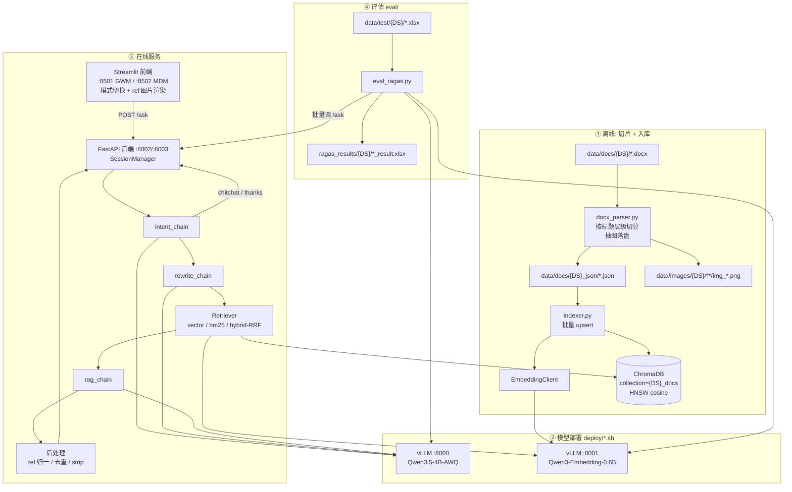

# MPMQA RAG 系统架构

> 项目根：`main/`。覆盖 **切片 → 入库 → 模型部署 → 后端 → 前端 → 跑批评估** 全流程。
> 支持多数据集（当前 GWM / MDM），通过 `--dataset` 做 collection / 路径 / 端口隔离。

> 🖼 **可交付的图**：本文是文字版说明；矢量图源在
> [`docs/diagrams/`](diagrams/) —— `rag-architecture.svg`（浏览器直接看）、
> `rag-architecture.drawio`（draw.io 打开可精修 / 导出高清 PNG）、
> `rag-architecture.html`（内嵌 SVG，带一键导出 PNG 按钮）。
> 三者由 `docs/diagrams/gen_architecture.py` 同源生成，坐标一致。
> 用法见 [`docs/diagrams/README.md`](diagrams/README.md)。

---

## 1. 总体架构图

```
┌──────────────────────────────────────────────────────────────────────────────┐
│                              离线阶段 (Offline)                                │
│                                                                              │
│  data/docs/{DS}/*.docx          data/docs/{DS}_json/*.json    data/chroma_db/  │
│         │                              │                       {ds}/chroma    │
│         ▼                              ▼                            ▲        │
│  ┌──────────────┐   chunks.json  ┌──────────────┐   embeddings  ┌────────────┐ │
│  │ docx_parser  │ ─────────────▶ │  indexer.py  │ ────────────▶ │  ChromaDB  │ │
│  │  按标题切分   │                │  批量 upsert │   (HTTP)      │  HNSW      │ │
│  │  抽图 → PNG  │                └──────┬───────┘               │  cosine    │ │
│  └──────┬───────┘                       │                        └────────────┘ │
│         ▼                               ▼                                      │
│  data/images/{DS}/{doc}/img_*.png   EmbeddingClient                            │
└─────────────────────────────────────────┼──────────────────────────────────────┘
                                          │ POST /v1/embeddings
┌─────────────────────────────────────────┼──────────────────────────────────────┐
│                      模型部署 (deploy/*.sh, vLLM)                                │
│                                                                                │
│   deploy_all.sh ──┬── deploy_chat.sh   → vllm serve Qwen3.5-4B-AWQ   :8000      │
│                   └── deploy_emb.sh    → vllm serve Qwen3-Embedding  :8001      │
│                        (GPU 显存配比 0.65 / 0.25，--enforce-eager)              │
└────────────────────────────────────────────────────────────────────────────────┘

┌──────────────────────────────────────────────────────────────────────────────┐
│                          在线阶段 (Online / Serving)                            │
│                                                                              │
│  ┌──────────────────────────────┐                                            │
│  │  前端 frontend/app.py        │   Streamlit  :8501(GWM) / :8502(MDM)        │
│  │  ─ session_id / 历史渲染      │                                            │
│  │  ─ 检索模式切换 (vector/      │                                            │
│  │    bm25/hybrid)              │                                            │
│  │  ─ [ref:uid] → 图片放大展示   │                                            │
│  └──────────────┬───────────────┘                                            │
│                 │ POST /ask {question, session_id, mode}                      │
│                 ▼                                                             │
│  ┌──────────────────────────────────────────────────────────────┐            │
│  │              FastAPI 后端  backend/api.py                      │            │
│  │              :8002 (GWM / collection=GWM_docs)                 │            │
│  │              :8003 (MDM / collection=MDM_docs)                 │            │
│  │                                                               │            │
│  │  SessionManager (内存, max=3条, TTL=1800s, 后台清理线程)         │            │
│  │         │                                                     │            │
│  │         ├─1. intent_chain   ──▶ thanks/chitchat? ─是─▶ 直接回复 │            │
│  │         │                                              (结束)  │            │
│  │         ├─2. rewrite_chain  ──▶ search_query (指代消解)         │            │
│  │         ├─3. Retriever.retrieve(search_query, mode)           │            │
│  │         │      ├─ vector_search (Chroma + 距离阈值)            │            │
│  │         │      ├─ bm25_search   (rank_bm25 内存索引)           │            │
│  │         │      └─ rrf_fuse      (RRF k=60 融合) ← hybrid       │            │
│  │         ├─4. rag_chain (system_prompt + history + context)     │            │
│  │         └─5. 后处理: normalize_ref_position → dedup_refs        │            │
│  │                    → strip_refs (存历史)                        │            │
│  └──────────────┬───────────────────────────────┬───────────────┘            │
│                 │ ChatOpenAI (OpenAI 兼容)       │ OpenAIEmbeddings          │
│                 ▼                               ▼                            │
│        :8000/v1  Qwen3.5-4B              :8001/v1 Qwen3-Embedding          │
└──────────────────────────────────────────────────────────────────────────────┘

┌──────────────────────────────────────────────────────────────────────────────┐
│                              评估阶段 (eval)                                   │
│                                                                              │
│  data/test/{DS}/*.xlsx ──▶ eval_ragas.py ──▶ 打 /ask (mode 可选)              │
│  (query, answer)             │  收集 answer + contexts                        │
│                              ▼                                                │
│                        Ragas 指标: faithfulness / answer_relevancy            │
│                                   context_precision / context_recall          │
│                              ▼                                                │
│                     ragas_results/{DS}/{doc}_{mode}_ragas_result.xlsx         │
│   (跑批入口: eval/run_eval.sh — DATASETS × MODES 组合遍历)                     │
└──────────────────────────────────────────────────────────────────────────────┘
```

---

## 2. Mermaid 版架构图



---

## 3. 目录结构

```
main/
├── quick_start.txt              # 全流程启动速查
├── deploy/                      # 模型服务部署
│   ├── common.sh                # conda rag 环境、CUDA、代理、wait_ready()
│   ├── deploy_chat.sh           # vllm serve 对话模型 :8000
│   ├── deploy_emb.sh            # vllm serve embedding 模型 :8001
│   └── deploy_all.sh            # 依次拉起 chat + emb
├── ingestion/                   # 切片 + 入库
│   ├── docx_parser.py           # docx → chunks json（标题切分 + 抽图）
│   ├── indexer.py               # chunks json → Embedding → Chroma
│   └── embedding_client.py      # /v1/embeddings 简易客户端
├── backend/                     # 在线服务
│   ├── api.py                   # FastAPI /ask + SessionManager
│   ├── chains.py                # LLM / rag_chain / intent_chain / rewrite_chain + ref 处理
│   ├── retriever.py             # Chroma 向量检索 + rank_bm25 + RRF 融合
│   ├── config.py                # AppConfig（端口/模型/top_k/prompt 路径/会话）
│   └── prompts/*.txt            # system / rewrite / intent / direct_reply
├── frontend/
│   ├── app.py                   # Streamlit 聊天页，[ref:uid] 内联渲染图片
│   └── config.py                # FrontendConfig + MODE_MAP + PROXIES
├── eval/
│   ├── eval_ragas.py            # Excel → /ask → Ragas 四指标 → xlsx
│   └── run_eval.sh              # DATASETS × MODES 批量跑
├── data/
│   ├── docs/{DS}/               # 原始 docx
│   ├── docs/{DS}_json/          # 切片产物
│   ├── images/{DS}/             # 抽取的图片
│   ├── chroma_db/{ds}/          # 持久化向量库
│   └── test/{DS}/               # 评估用 Excel(query, answer)
└── ragas_results/{DS}/          # 评估结果 xlsx
```

---

## 4. 端口与实例对照

| 组件 | 端口 | 说明 |
|---|---|---|
| vLLM chat | 8000 | `qwen3.5-4b`（served-model-name） |
| vLLM embedding | 8001 | `qwen3-embedding-0.6b` |
| 后端 GWM | 8002 | `collection=GWM_docs` |
| 后端 MDM | 8003 | `collection=MDM_docs` |
| 前端 GWM | 8501 | `--api-url .../8002/ask` |
| 前端 MDM | 8502 | `--api-url .../8003/ask` |

---

## 5. 一次问答的完整链路

```
用户提问 → Streamlit → POST /ask
   ├─ SessionManager 记录 user 消息（只保留最近 3 条）
   ├─ intent_chain 判定意图 ──► 闲聊/致谢 ⇒ 直接回复，返回空 sources
   ├─ rewrite_chain 改写 query（多轮指代消解，去 "rewritten query:" 前缀）
   ├─ Retriever.retrieve(mode) → top_k=10
   │     vector : Chroma 余弦距离 ≤ score_threshold(1.0)
   │     bm25   : rank_bm25 关键词打分
   │     hybrid : 两路召回 + RRF(k=60) 融合
   ├─ rag_chain → 带 [ref:uid] 的答案（system prompt + history + context）
   └─ normalize_ref_position → dedup_refs → strip_refs（清洗后入会话历史）
返回 {answer, sources[], images[]} → 前端按 [ref:uid] 内联渲染图片
```

---

## 6. 关键设计点

| 维度 | 实现 |
|---|---|
| 多数据集隔离 | `--dataset` 驱动 collection 名（`{DS}_docs`）、chroma 路径（小写）、图片目录、后端端口 |
| 切片策略 | 按 Heading 层级维护 `title_path`，遇新标题或图片边界 flush；标题回填进正文；`seg_id` 同标题段内自增 |
| 图片 | 切片时抽图落盘 `img_XXXX.png`；入库只存相对文件名（剥掉 `./data/images/{DS}/` 前缀）；前端用 `--image-base` 还原绝对路径 |
| 引用机制 | LLM 输出 `[ref:uid]` → 后端只保留「确有图片」的 ref 并去重（`dedup_refs`）→ 前端定位并放大展示图片 |
| 会话 | 纯内存 `SessionManager`，后台守护线程按 TTL(1800s) 清理，默认 session `default` |
| Prompt | 全部外置 `backend/prompts/*.txt`，由 `AppConfig.load_prompt` 读取 |
| 评估 | Ragas：faithfulness / answer_relevancy / context_precision / context_recall，评估用 LLM 与 embedding 复用同一对 vLLM 服务 |

---

## 7. 启动顺序

```bash
# 0. 模型服务（chat:8000 + emb:8001）
bash deploy/deploy_all.sh

# 1. 切片
python ingestion/docx_parser.py --dataset GWM
python ingestion/docx_parser.py --dataset MDM

# 2. 入库
python ingestion/indexer.py --dataset GWM
python ingestion/indexer.py --dataset MDM

# 3. 后端
python backend/api.py --dataset GWM --port 8002
python backend/api.py --dataset MDM --port 8003

# 4. 前端
streamlit run frontend/app.py --server.port 8501 -- \
  --api-url http://127.0.0.1:8002/ask \
  --image-base ./data/images/GWM/ --title-suffix "[GWM]"

# 5. 跑批评估
bash eval/run_eval.sh
# 或单次
python eval/eval_ragas.py --dataset GWM --mode vector
```

> 注意：所有命令需在 `main/` 根目录下执行（配置里使用 `./data/...` 相对路径），且脚本中 `cd`/`deploy` 依赖 conda 环境 `rag`。
